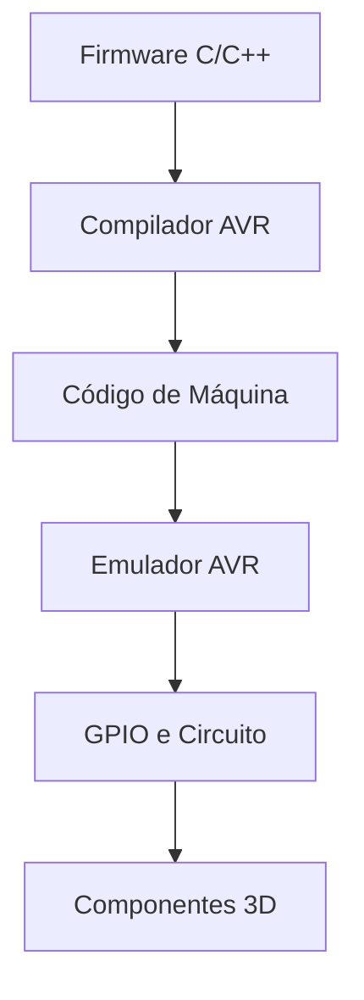

# Arduino 3D Lab

**Simulador experimental de Arduino em 3D**, desenvolvido em **C++20 para Linux**, com renderização **OpenGL**, emulação **AVR** e simulação de circuitos eletrônicos.

O objetivo é permitir a montagem de circuitos virtuais, a execução de firmware compilado para AVR e a visualização do comportamento dos componentes em um ambiente 3D.

## Objetivos

* Desenvolver um emulador AVR próprio, começando pelo ATmega328P.
* Executar firmware compilado, sem depender apenas da interpretação do código-fonte.
* Simular GPIO, conexões e componentes eletrônicos.
* Visualizar circuitos em 3D.
* Salvar e carregar projetos em JSON.

> [!NOTE]
> **Status:** Projeto experimental em desenvolvimento. Os recursos serão implementados progressivamente, sem pressupor compatibilidade completa com Arduino ou AVR.

## Tecnologias

| Tecnologia | Finalidade |
| :--- | :--- |
| **IA** | Geração e implementação |
| **C++20** | Linguagem principal |
| **OpenGL, GLFW e GLAD** | Renderização 3D |
| **GLM** | Matemática gráfica |
| **Dear ImGui** | Interface |
| **CMake e Ninja** | Build |
| **avr-g++ e avr-libc** | Compilação do firmware |
| **nlohmann/json** | Persistência de projetos |
| **CTest** | Testes automatizados |

## Estrutura do Projeto

```text
arduino-3d-lab/
├── CMakeLists.txt
├── README.md
├── assets/
│   ├── models/
│   └── shaders/
├── firmware/
│   └── include/
├── src/
│   ├── main.cpp
│   ├── app/
│   ├── graphics/
│   ├── circuit/
│   ├── emulator/
│   └── project/
└── tests/

```

## Arquitetura

| Módulo | Descrição |
| :--- | :--- |
| **app** | Inicialização da aplicação e interface de edição. |
| **graphics** | Câmera, cena e renderização 3D. |
| **circuit** | Componentes, pinos, fios e propagação de estados. |
| **emulator** | Memória, instruções AVR e GPIO. |
| **project** | Gerenciamento e serialização de projetos. |
| **firmware** | Programas de exemplo e interface mínima Arduino. |
| **tests** | Testes de memória, GPIO e circuitos. |

## Fluxo de Execução



## Primeiro Marco: Blink

Executar um firmware que alterna um LED entre ligado e desligado, validando a integração entre compilação, emulação AVR, GPIO, circuito e renderização.

### Exemplo de Firmware

```cpp
#include <Arduino.h>

int main() {
    pinMode(13, OUTPUT);
    while (true) {
        digitalWrite(13, HIGH);
        delay(1000);
        digitalWrite(13, LOW);
        delay(1000);
    }
}
```

*Esse exemplo representa o comportamento esperado. Sua execução depende da implementação das funções Arduino utilizadas, das instruções AVR necessárias e da temporização simulada.*

## Compilação

Em sistemas **Debian** ou **Ubuntu**, instale as ferramentas básicas executando o comando abaixo:

```bash
sudo apt update
sudo apt install build-essential cmake ninja-build \
    pkg-config libglfw3-dev libgl1-mesa-dev \
    libglm-dev gcc-avr avr-libc binutils-avr
```

Configure o GLAD, Dear ImGui e nlohmann/json conforme a configuração do projeto. Quando o `CMakeLists.txt` estiver implementado:

```bash
cmake -S . -B build -G Ninja
cmake --build build
ctest --test-dir build --output-on-failure
```

## Roadmap

1. Configuração do projeto e janela OpenGL.
2. Modelos 3D e câmera.
3. Componentes e conexões elétricas.
4. GPIO e emulador AVR.
5. Compilação e carregamento de firmware.
6. Integração entre emulador, circuito e renderização.
7. Editor de circuitos, salvamento JSON e depuração.
8. Testes, documentação e melhorias de compatibilidade.

## Princípios

* C++ moderno e arquitetura modular.
* Desenvolvimento nativo em Linux, sem Docker.
* Testes automatizados e evolução incremental.
* Limitações e funcionalidades documentadas com transparência.

## Licença

Ainda a definir.
